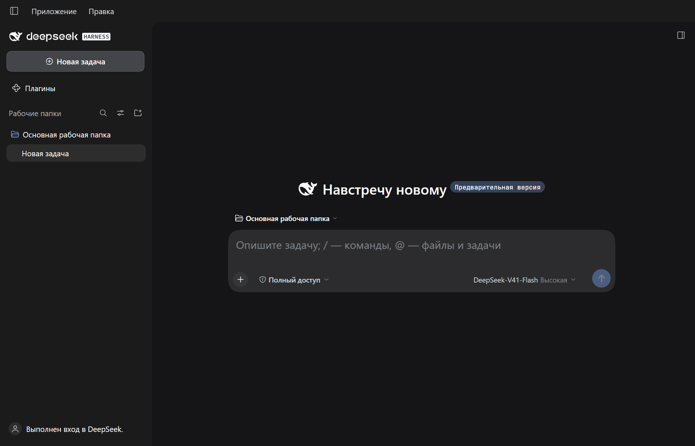
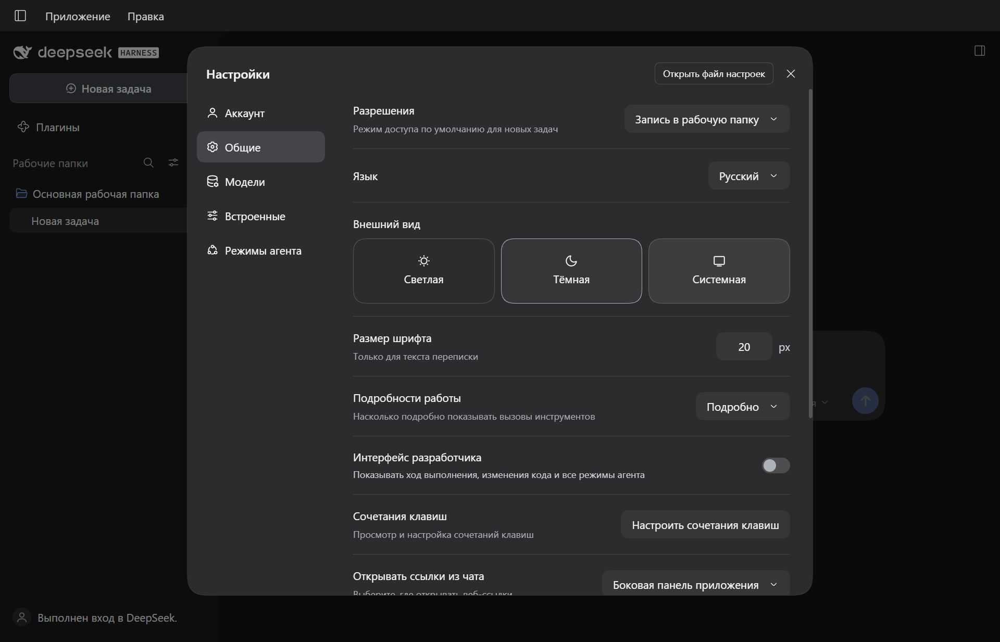

# DeepSeek Harness — русская локализация

Неофициальный русский языковой пакет для **официального DeepSeek Harness Desktop на Windows**.

Переведены основные элементы чата, настройки, рабочие папки, режимы агента, интерфейс плагинов, задания, просмотр файлов и меню настольной оболочки. «Русский» появляется в списке языков рядом с English и 中文. Переключение применяется без перезапуска.



## Совместимость

| Параметр | Проверенная версия |
|---|---|
| Приложение | Официальный DeepSeek Harness Desktop |
| ОС | Windows x64 |
| Версия | `0.2.0-rc.2` |
| Коммит приложения | `04f392c9ddd144fa426da2045178797da6db6c11` |
| SHA-256 исходного `app.asar` | `983ca71114e6dfd353fc79af5a1f9481a250ee64c2a3c757673029b811b23bc2` |

**Другая версия или сторонняя сборка:** установщик остановится до изменения файлов. Это не универсальный патч для всех приложений с названием DeepSeek Harness.

## Установка

1. Скачайте ZIP из [Releases](https://github.com/XaarBot/deepseek-harness-ru/releases) и распакуйте его.
2. Если приложение ещё ни разу не запускалось, откройте его один раз. Затем полностью выйдите через **Application → Quit**. Закрытие окна может только свернуть приложение в трей.
3. В PowerShell из распакованной папки выполните:

```powershell
powershell -NoProfile -ExecutionPolicy Bypass -File .\install.ps1
```

`ExecutionPolicy` задаётся только для этого запуска PowerShell. Скрипт не меняет постоянную политику Windows. Отдельно устанавливать Node.js, Python или npm не требуется: используется Node.js, поставляемый с приложением. Пакет устанавливается локально с `--offline --ignore-scripts`.

Проверить совместимость без установки:

```powershell
powershell -NoProfile -ExecutionPolicy Bypass -File .\install.ps1 -CheckOnly
```

Если приложение установлено в другую папку:

```powershell
powershell -NoProfile -ExecutionPolicy Bypass -File .\install.ps1 -InstallDirectory 'D:\Apps\DeepSeek Harness'
```

После установки приложение откроется на русском. Язык меняется через **Настройки → Общие → Язык**. Английский и китайский словари сохраняются.



## Что изменяется

- Языковой пакет копируется в `%LOCALAPPDATA%\DeepSeekHarness-Russian\language-pack` и подключается штатной командой `dsh plugin` в профиль `desktop`.
- В настройках профиля записывается `locale.preference: ru`.
- Для меню Windows, окна входа и уровней рассуждения добавляется русский перевод в четыре файла внутри `resources\app.asar`. Остальные файлы архива сохраняются.
- Перед изменением оболочки проверяется версия и SHA-256, сохраняется оригинальный архив. Настройки профиля также резервируются.

Чаты, ключи API, аккаунты, выбранные модели, разрешения и настройки отправки журналов не изменяются. Исходники приложения, исполняемые файлы и пользовательские данные в этом репозитории не распространяются. Автообновление приложения не отключается.

После успешной установки распакованный репозиторий можно переместить или удалить: установленный пакет находится в постоянной папке. Для удаления локализации сохраните ZIP или скачайте его снова.

## Откат

Полностью выйдите из приложения и выполните:

```powershell
powershell -NoProfile -ExecutionPolicy Bypass -File .\uninstall.ps1
```

Скрипт проверит контрольные суммы, восстановит оригинальную оболочку, переключит язык на английский и отключит пакет через штатный менеджер. Чаты и аккаунт сохраняются. Резервные копии остаются в `%LOCALAPPDATA%\DeepSeekHarness-Russian`.

После обновления самого приложения **не копируйте старый `app.asar` поверх новой версии**. Удаление патча от другой версии намеренно блокируется. Если новая версия работает, но оболочка снова английская, оставьте языковой пакет и дождитесь совместимого патча.

## Объём и ограничения

- 2 623 записи в языковом пакете: 2 615 исходных строк интерфейса и 8 подписей уровней рассуждения.
- 165 строк оболочки: меню, вход, запуск, обновления и сообщения об ошибках.
- Перевод подготовлен с машинной основой; основные экраны и терминология вычитаны. В редких диагностических сообщениях и длинных справочных текстах возможны неточные формулировки.
- Названия моделей, технические идентификаторы, сторонние описания плагинов, ответы модели и сообщения, приходящие от сервера, могут оставаться на исходном языке.
- Проверены главный экран, общие настройки, режимы агента, переключение English ↔ Русский и сохранение языка после перезапуска. Наличие перевода строки не означает, что каждый редкий диалог был вызван вручную.
- Обновление приложения может заменить патч оболочки; новые строки потребуют обновления словаря.

Исправления перевода принимаются через Issues и Pull Requests. Для сообщения об ошибке укажите версию приложения, экран и исходную/предлагаемую формулировку; не прикладывайте ключи, токены и личную переписку.

## Разработка

Нужен Node.js 22 или новее. Внешних npm-зависимостей нет.

```sh
npm run build
npm test
```

- `plugin/ru.json` — перевод интерфейса.
- `shell.ru.json` — перевод настольной оболочки.
- `reference/` — исходные английские строки для проверки ключей и подстановок.
- `scripts/build.mjs` — генерация клиентского пакета.
- `scripts/patch-shell.mjs` — ограниченный конкретной сборкой патч и откат.
- `tests/` — целостность словарей, подстановки, чтение/изменение ASAR и сохранность соседних настроек.

Нельзя переводить имена переменных `{name}`, `{count}`, `{path}` и технические значения вроде `onboardingArtworkLocale: "en"`. После изменения словаря запустите сборку и тесты; `plugin/lib/client.js` хранится в Git, чтобы установка не требовала сборщика.

## Источники и лицензия

Основано на механизме [языковых пакетов DeepSeek Harness](https://github.com/deepseek-ai/deepseek-harness/tree/master/packages/client/locale) и [официальной настольной оболочке](https://github.com/deepseek-ai/deepseek-harness/tree/master/apps/desktop). Проект не связан с DeepSeek и не является официальным переводом. MIT, см. [LICENSE](LICENSE) и [NOTICE](NOTICE).
